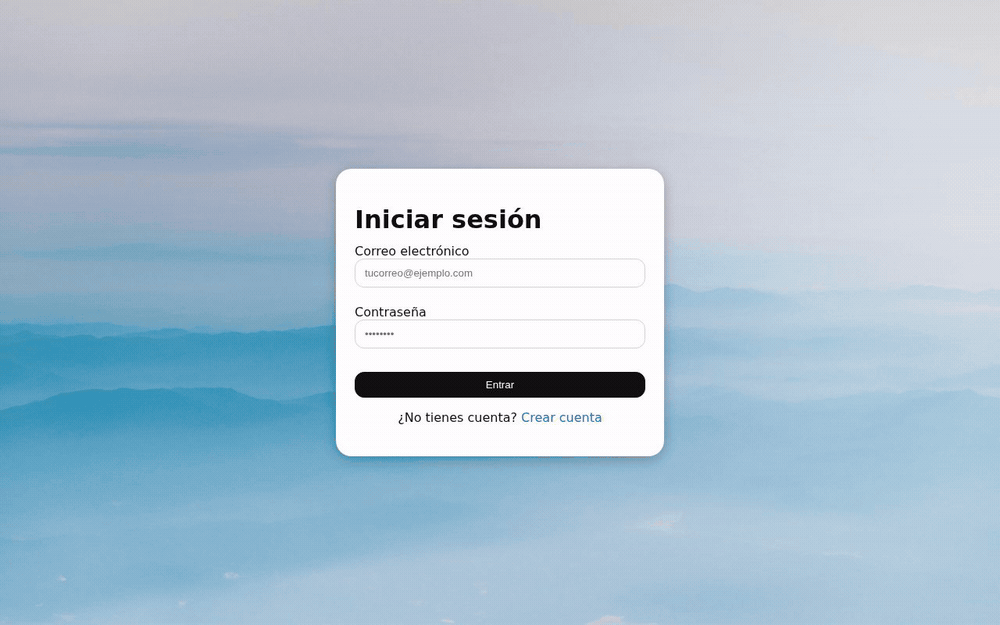

# EventEase 📅

A web platform for planning events collaboratively: create an event, invite people,
manage teams, track who is coming, and keep it all on one calendar.



## Features

- **Events:** create and organise them, with date, place and visibility.
- **Invitations:** send them to other users, accept or decline, see status in real time.
- **Teams:** group people once and invite the whole team to an event.
- **Contacts:** friend requests and a people directory.
- **Calendar:** a combined view of everything you are invited to or hosting.
- **Auth:** email and password, sessions signed server-side.

## Stack

- **Frontend:** React 19, React Router 7, Vite. Plain CSS, no UI framework.
- **Backend:** Python 3.11, FastAPI, SQLAlchemy, PostgreSQL.
- **Deploy:** Docker Compose (Postgres + API), frontend served by Vite or a static host.

## Run it locally

```bash
cp .env.example .env          # database credentials, DOMAIN and SECRET_KEY
docker compose up -d db backend

cd frontend
npm install
npm run dev                   # http://localhost:5173, /api proxied to :25000
```

The API creates its tables and a demo dataset on first start, so the app is not empty.

## Layout

```
backend/     FastAPI app: routers, models, schemas
frontend/    React app: pages, sections, shared components
compose.yml  Postgres + API
```
